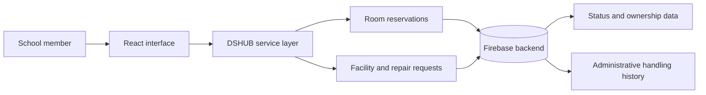

<p align="center">
  <a href="#introduction">
    
  </a>
</p>
<p align="center">
  <br />
  <a href="#introduction"><strong>Introduction</strong></a> ·
  <a href="#architecture"><strong>Architecture</strong></a> ·
  <a href="#operational-model"><strong>Operational Model</strong></a> ·
  <a href="#design-lessons"><strong>Design Lessons</strong></a>
</p>

<p align="center">
  
  
  
  
</p>

## Introduction

DSHUB is a campus operations hub built to replace recurring school workflows that depended on paper, verbal handoffs, and personal messaging. It brought special-room reservations and facility or repair requests into a shared web service that school members could actually use and administrators could maintain.

The project demonstrated that digitizing a workflow is not only a matter of building forms. Reservation conflicts, edit ownership, request-state tracking, and administrative history all require explicit data and permission rules once real users begin depending on the service.

## Key Features

| Feature | Description |
| --- | --- |
| Special-room reservations | Centralizes room availability and reservation records to reduce schedule collisions. |
| Facility and repair requests | Replaces fragmented reports with trackable requests and status updates. |
| Shared operational view | Gives school members and administrators a common view of ongoing work. |
| Status-based workflow | Represents each request as an object that moves through explicit operational states. |
| Administrative handling | Separates ordinary submissions from actions that change or resolve operational records. |
| Continuous maintenance | Incorporates issues discovered after deployment instead of treating launch as completion. |

## Architecture

DSHUB operated as a React-based interface backed by Firebase services. The initial implementation prioritized rapid deployment and practical adoption inside the school.



## Operational Model

Different workflows protect different assets and therefore need different rules.

| Workflow | Core data requirement | Core permission question |
| --- | --- | --- |
| Room reservation | Time slot, room, owner, and current state | Who may create, change, or cancel this reservation? |
| Facility or repair request | Request details, processing state, and handling history | Who may view, update, or resolve the request? |
| Administrative action | Actor, target object, transition, and timestamp | Is the current user allowed to perform this transition? |

This object-and-state view became more reliable than designing permissions around individual screens. A hidden button can improve usability, but it cannot serve as the final authorization boundary.

## Design Lessons

### From Fast Deployment to Explicit Trust Boundaries

The early DSHUB implementation used broad Firestore read and write rules to move quickly. Operation with real users exposed the weakness of assuming that client-side restrictions were sufficient. A modified client could bypass the interface unless the backend independently enforced ownership, role, and state rules.

This limitation became a concrete design input for later systems: role resolution should live in server-side functions, object access should be enforced at the data layer, and sensitive administrative actions should be separately restricted and recorded.

### Development Continues After Deployment

DSHUB established an operating cycle in which problems found during use returned to the design process.

```text
Observe the live workflow
  → reproduce the failure or ambiguity
  → clarify data ownership and state transitions
  → apply a focused change
  → verify both normal and unauthorized paths
  → document the operational reason
```

### Transferable Security Baseline

The project's operational lessons informed the stricter architecture later applied to Student Voice: server-side role checks, object-level data policies, explicit state validation, limited sensitive functions, and auditable administrative actions.

## Operational Evidence

| Area | What operation revealed | Resulting engineering principle |
| --- | --- | --- |
| Reservations | Schedule collisions and edit ownership matter after multiple users participate. | Validate conflicts and ownership at the authoritative backend. |
| Facility requests | Submission alone is insufficient without status and handling history. | Model state transitions and administrative responsibility explicitly. |
| Client-side controls | Hidden or disabled controls can be bypassed. | Treat the server and data layer as the trust boundary. |
| Maintenance | User behavior and school procedures continue to change after launch. | Include regression and operational-state checks in each change cycle. |
| Handover | Future maintainers need to understand why restrictions exist. | Preserve decisions in data contracts, code structure, and migration history. |

## Technical Scope

- Interface: React-based web UI.
- Backend: Firebase-family services used for the deployed campus hub.
- Operational domains: special-room reservations and facility or repair requests.
- The initial broad Firestore rules are documented as an architectural limitation and a source of later security improvements, not presented as a finished security model.
- This README is based on the implementation and operational lessons recorded in the project portfolio. Reproducible setup instructions can be added when repository configuration and deployment details are available.

---

<p align="center">
  <strong>DSHUB</strong><br />
  <sub>Keeping everyday school operations in one place.</sub>
</p>
